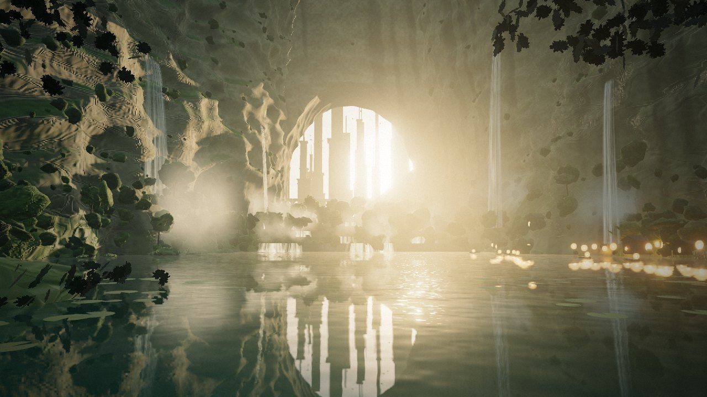
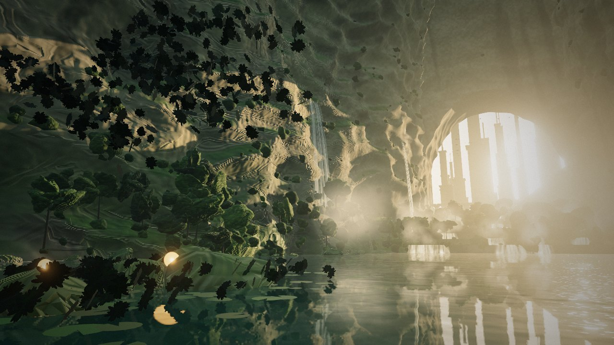
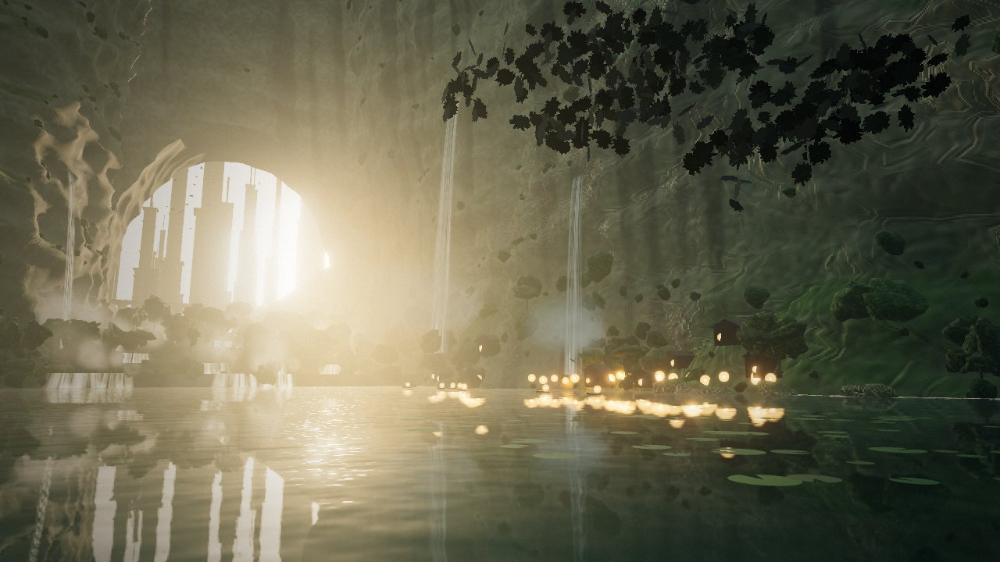
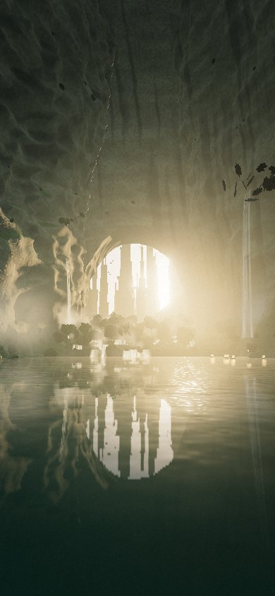

# 峡谷拱门（Three.js 纯代码场景）

参考一张奇幻风景图做的场景：巨大的天然石拱，拱门外是逆光里的高塔和高架桥，
两侧岩壁挂着瀑布，中间是层层跌落的小瀑布，前景是能倒映一切的湖面，右岸有亮着灯的小村子。

没有加载任何模型、贴图或音频文件，岩壁、植被、瀑布、城市、声音都是代码实时生成的。

**直接打开就能看：**
[htmlpreview.github.io/?…/index.html](https://htmlpreview.github.io/?https://github.com/historycrew5423-art/kiro-chat-archive/blob/main/files/2026-11-04-canyon-arch/index.html)

| 正面 | 向左看 |
| --- | --- |
|  |  |
| **向右看（村子）** | **手机竖屏** |
|  |  |

截图来自无显卡的无头浏览器（软件渲染）。真机上的效果和帧率要自己打开看，有问题请告诉 Kiro。

## 操作

- 按住鼠标拖动：环顾四周（有角度限制）。5 秒不操作会恢复缓慢的漂移镜头。
- 右下角按钮：开启或关闭声音（瀑布、流水、鸟叫，全部实时合成）。

## 用到的做法

| 效果 | 做法 | 文件 |
| --- | --- | --- |
| 岩体 | 拱门正面、洞口内壁、左右岩壁、台阶都是先生成简单形状的网格，再加同一个三维噪声位移场。位移只取决于位置，所以不同网格的接缝不会裂开 | `src/rock.js` |
| 岩石质感 | 在 `MeshStandardMaterial` 里注入代码：三向投影的噪声算出岩层、水渍、苔藓和竖向节理，再用屏幕导数做凹凸。保留 three 自带的光照和阴影 | `src/materials.js` |
| 大气 | 替换 three 的雾代码块：越靠近水面雾越浓，朝太阳方向的雾发出暖光。所有材质共用一套雾 | `src/atmosphere.js` |
| 逆光 | 太阳在拱门后面。阴影贴图负责岩体的明暗；树叶透光、瀑布发光、水面闪光用“从这个点朝太阳看，视线是否穿过洞口”来近似判断 | `src/atmosphere.js` |
| 光束 | 后期从太阳位置向外做径向模糊，岩石和树叶挡住的地方留下暗缝 | `src/post.js` |
| 植被 | 按岩面朝向和高度在岩壁顶点上撒点，每处 1~3 团灌木；岸边的树；画面上角和左下角用叶片贴图的小面片 | `src/vegetation.js` |
| 湖面 | `Reflector` 真实倒影 + 几组波浪和噪声扭曲 + 菲涅尔 + 被噪声打散的太阳碎光。台阶上的小水潭用便宜的假反射 | `src/water.js` |
| 瀑布 | 沿抛物线弯下去的条带，用拉长的噪声画出流动的水丝和水沫；底部有雾气粒子 | `src/falls.js` |
| 远方城市 | 分段收窄的塔楼和带拱券的高架桥，靠雾变成淡金色剪影 | `src/city.js` |
| 村子 | 木屋、窗光、灯笼、小船、睡莲叶 | `src/village.js` |
| 后期 | 坏像素清零 → 光束 → 泛光 → 调色 → ACES → 暗角和颗粒 | `src/post.js` |

## 画质档位

电脑默认 `high`，手机默认 `mobile`。网址后面可以加参数：

- `?q=high` / `?q=mobile` / `?q=low`
- `?debug`：左上角显示帧率、分辨率倍率和场景生成耗时

运行后前几秒如果平均帧率低于 28，会自动降低渲染分辨率。

## 本地运行

```bash
npm install
npm run build      # 把 src/ 打包成 app.js
node serve.mjs     # 打开 http://localhost:8765
```

调试截图：控制台执行 `__scene.shot({ t: 20, yaw: -0.03, pitch: 0.11 })` 渲染固定的一帧并停住，`__scene.resume()` 恢复。

## 和参考图的差距

- 参考图是 AI 生成的静态图，细节密度远高于实时渲染。这里的植被是成团的形状，不是一片片叶子。
- 岩壁和拱门的造型是噪声生成的，没有参考图那种精心雕琢的轮廓。
- 远方城市只是剪影，没有建筑细节。
- 没有人物。
