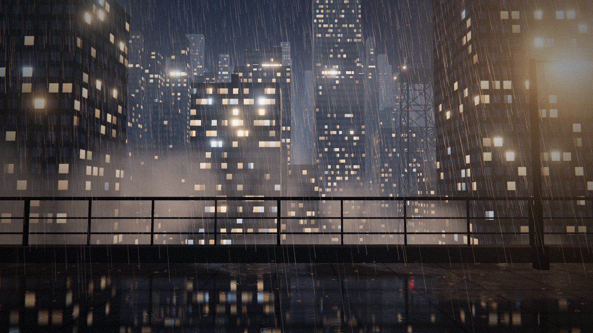
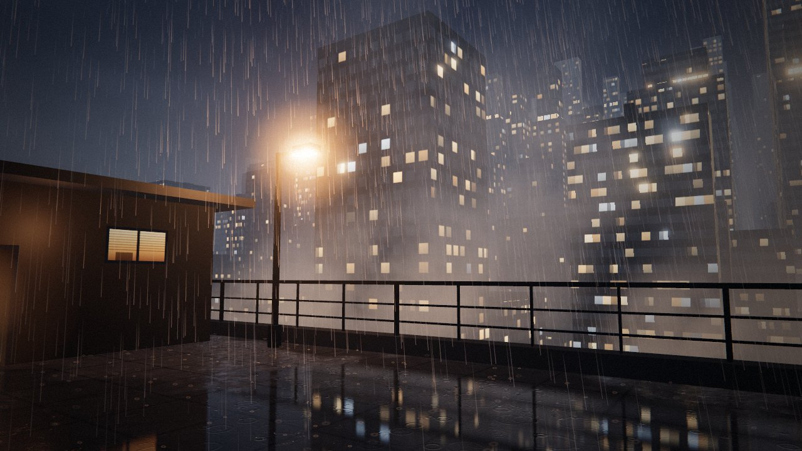
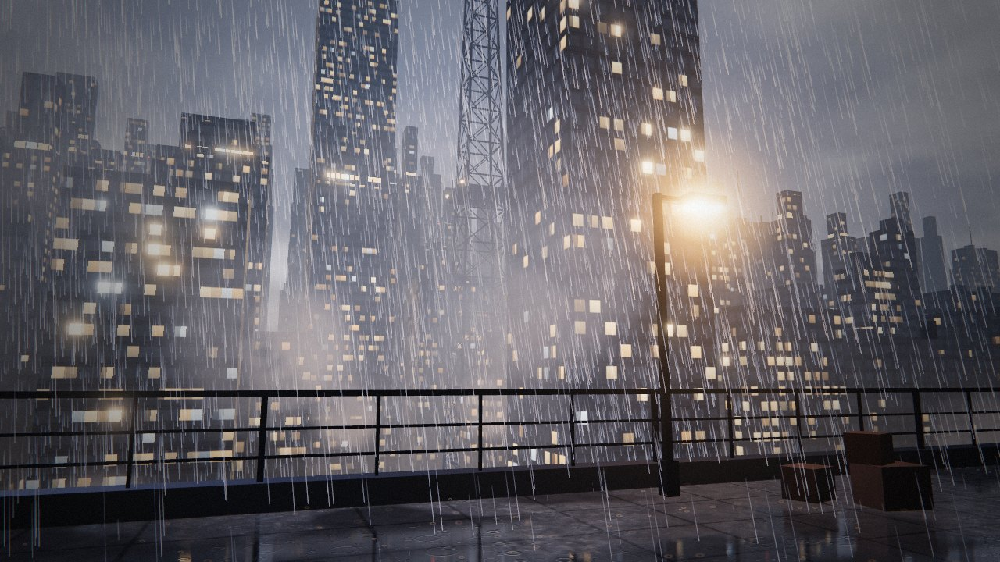
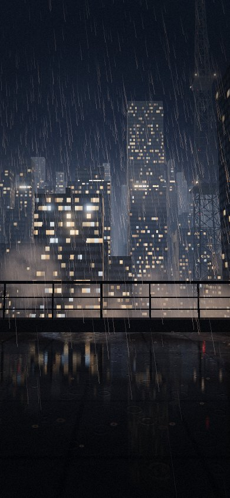

# 雨夜城市（Three.js 纯代码场景）

参考一段 gamejam 视频的雨夜天台画面做的场景，暂时不含人物。
没有加载任何模型、贴图或音频文件：楼、窗户、雨、蒸汽、积水倒影、雨声都是代码实时算出来的。

**直接打开就能看：**
[htmlpreview.github.io/?…/index.html](https://htmlpreview.github.io/?https://github.com/historycrew5423-art/kiro-chat-archive/blob/main/files/2026-11-04-rainy-city/index.html)

这个链接通过第三方的 htmlpreview 服务读取仓库里 `main` 分支的最新文件，不需要任何设置。

如果以后在仓库 Settings → Pages 里开启了 GitHub Pages（分支 `main`，目录 `/ (root)`），也可以用这个地址：
https://historycrew5423-art.github.io/kiro-chat-archive/files/2026-11-04-rainy-city/

| 正面 | 左转看小屋 |
| --- | --- |
|  |  |
| **闪电** | **手机竖屏** |
|  |  |

截图来自无显卡的无头浏览器（软件渲染），真机上的效果和帧率需要自己打开看。

## 操作

- 拖动画面：环顾四周（有角度限制）。5 秒不操作会恢复缓慢的自动摇镜。
- 右下角按钮：开启或关闭雨声。iPhone 开着静音键时听不到网页声音。
- 每隔十几到三十秒会打一次闪电，开着雨声时随后会有雷声。

## 用到的做法

| 效果 | 做法 | 文件 |
| --- | --- | --- |
| 楼群 | 约 6000 个立方体实例，1 次绘制。窗户、亮灯、窗帘、底商、楼板线全在片元着色器里按楼的尺寸算；远处窗格小于一两个像素时换成块平均亮度，避免闪烁 | `src/city.js` |
| 格构塔、塔吊、天线 | 用“两端点 + 粗细”描述每根杆件，全部合成一个实例网格 | `src/city.js` |
| 湿地面 | `Reflector` 渲染镜像图，按噪声分出积水和湿水泥：积水处清晰反射，湿水泥处用模糊 mip 并沿竖直方向拉长；叠加雨滴涟漪法线、地砖缝和灯光高光 | `src/terrace.js` |
| 雨 | 近、远两层线段，下落在顶点着色器里算；亮度按到路灯的距离计算，所以灯下的雨最亮。另有地面水花和远处雨幕 | `src/rain.js` |
| 蒸汽 | 朝向镜头的大面片，采样预先算好的可平铺噪声图，按高度从街灯暖色过渡到天空冷色 | `src/steam.js` |
| 天空和闪电 | 渐变 + 噪声云层；闪电时天空、楼、地面、雨一起提亮 | `src/sky.js`、`src/main.js` |
| 后期 | 泛光 → 线性空间调色（暗部偏青、亮部偏暖）→ ACES 色调映射 → 轻微色散、暗角、胶片颗粒 | `src/post.js` |
| 雨声 | Web Audio 合成：滤波噪声做雨幕和沙沙声，随机短脉冲做雨滴，低通噪声做雷声 | `src/audio.js` |

## 画质档位

手机默认 `mobile`，电脑默认 `high`。可以在网址后面加参数强制指定：

- `?q=high` / `?q=mobile` / `?q=low`
- `?debug`：左上角显示帧率和当前分辨率倍率

运行后前几秒如果平均帧率低于 28，会自动降低渲染分辨率。

## 本地运行

```bash
npm install
npm run build      # 把 src/ 打包成 app.js
node serve.mjs     # 打开 http://localhost:8765
```

`app.js` 是打包好的文件，已经提交，GitHub Pages 直接用它。改了 `src/` 之后要重新 `npm run build`。

调试截图：在控制台执行 `__rainy.shot({ t: 20, yaw: 0, pitch: 0.07, flash: 0 })`，会用固定时间和视角渲染一帧后停住，`__rainy.resume()` 恢复。

## 做之前查到的资料

- three.js 当前最新版本是 r187（2026-10-30 发布）。项目锁定 `three@0.187.0`，并用当前的 API（比如用 `Timer` 而不是已弃用的 `Clock`）。来源：[three.js r187 release](https://github.com/mrdoob/three.js/releases/tag/r187)、[utsubo 的 2026 版本变化整理](https://www.utsubo.com/blog/threejs-2026-what-changed)。
- 用 AI 写 Three.js 时，先定计划，每次只改一处，每轮都看浏览器里实际渲染出来的画面，能用的版本就提交。来源：[threejsresources.com/ai](https://threejsresources.com/ai)。这个场景就是这样迭代的：每次改完都截图检查。
- 只说“画面要好看”不够，要给出具体的实现手法。来源：[threejs-awesome-graphics-agent-skills](https://github.com/scottstts/threejs-awesome-graphics-agent-skills)。
- 湿地面的思路参考了 [Threejs-Punk 的 wet-ground 文档](https://github.com/ektogamat/threejs-conference/blob/main/docs/techniques/wet-ground.md)：用单独的镜像渲染代替屏幕空间反射，按粗糙度控制反射强度，用世界坐标算涟漪。这里没有复制代码，是按同样思路用 WebGL 重写的。
- 提示词写法参考了 [awesome-opus-5.5 的 prompt guide](https://github.com/sandbase-lab/awesome-opus-5.5/blob/main/docs/prompt-guide.md)：说清交付物、设一个质量标准、列出禁止项、最后要求自检。

为什么用 WebGL 而不是 WebGPU：WebGPU + TSL 是 three.js 更新的方向，但 `WebGPURenderer` 在不支持的浏览器上本来也会退回 WebGL 2，而这里的验证环境只有软件 WebGL。为了每一步都能截图确认，这一版用 `WebGLRenderer`。

## 已知限制

- 没有人物。
- 雨丝是 1 像素宽的线，高分辨率屏幕上偏细。
- 还没在真机上测过帧率，手机档位是按经验设的。
