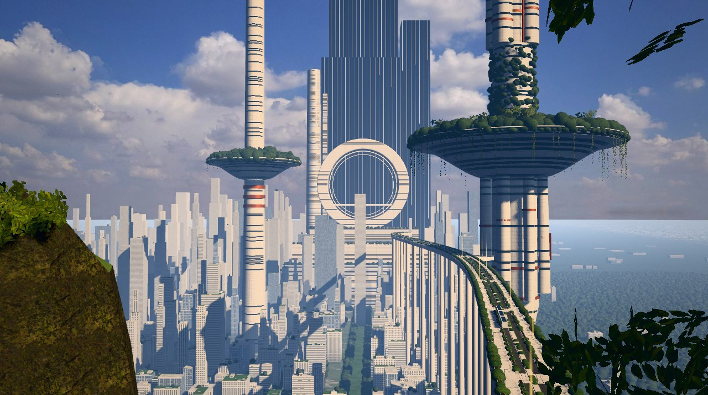
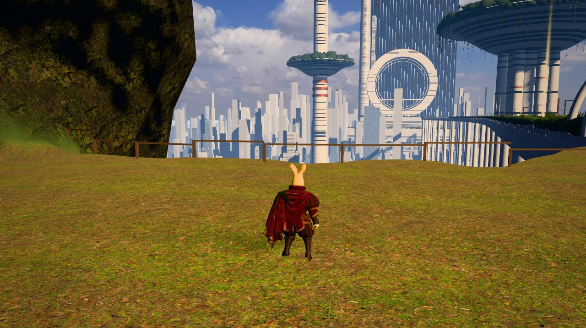
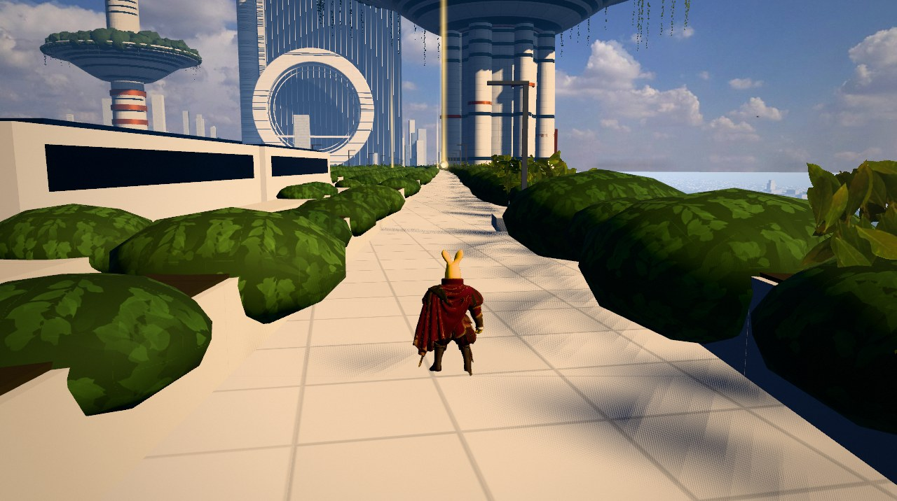

# 绿环之城（Three.js 第三人称小游戏）

按用户给的太阳朋克城市图做的游戏。主角是用户提供的袋鼠火枪手模型。
参考图拆解和设计思路见 [DESIGN.md](DESIGN.md)。

**直接打开就能玩（电脑浏览器）：**
[htmlpreview.github.io/?…/index.html](https://htmlpreview.github.io/?https://github.com/historycrew5423-art/kiro-chat-archive/blob/main/files/2026-11-05-solarpunk-game/index.html)

第一次打开要下载约 5 MB 素材，等进度条走完。

**开场镜头（按参考图构图）**



| 山顶出发 | 高架绿廊 |
| --- | --- |
|  |  |

截图来自没有显卡的无头浏览器（软件渲染），真机上的效果和帧率请自己打开确认。

**当前进度（2026-11-05）**：能玩通。开始、移动、跳、收集 10 颗种子、电梯启动、坐电梯都在浏览器里测过。
还没做完的：空中花园上面的细节、花园平台的截图、真机帧率。

## 怎么玩

- 目标：收集 **10 颗阳光种子**（会发光、头顶有光柱），然后走进空中花园塔下连接站的电梯，坐电梯上到空中花园。
- 种子分布：山顶公园 3 颗、高架步道 6 颗（其中一颗悬在长椅上方，要跳）、连接平台 1 颗。
- 高架中间是轨道，有电车来回跑。只有车站和三处人行横道能穿过轨道，被电车撞到会被送回去。

| 操作 | 按键 |
| --- | --- |
| 移动 | W A S D / 方向键 |
| 大步跳（跑） | 按住 Shift |
| 跳 | 空格 |
| 转镜头 | 按住鼠标拖动 |
| 镜头远近 | 鼠标滚轮 |

## 用到的素材

| 素材 | 来源 | 许可 |
| --- | --- | --- |
| 天空照片 `assets/sky_*.jpg` | [Poly Haven · kloofendal_48d_partly_cloudy_puresky](https://polyhaven.com/a/kloofendal_48d_partly_cloudy_puresky)，裁掉了地平线以下 | CC0 |
| 树叶 `assets/leaves.webp` | 用 [Poly Haven · island_tree_02](https://polyhaven.com/a/island_tree_02) 的叶片贴图拼成的叶簇 | CC0 |
| 岩石 `assets/mossy_rock_*.jpg` | [Poly Haven · mossy_rock](https://polyhaven.com/a/mossy_rock)，重新压缩 | CC0 |
| 草地 `assets/leafy_grass_*.jpg` | [Poly Haven · leafy_grass](https://polyhaven.com/a/leafy_grass)，重新压缩 | CC0 |
| 主角 `assets/character.glb` | 用户提供，Tripo 生成；贴图从 5.3 MB 压缩到 1.2 MB | 未注明，见下方说明 |

建筑、高架、圆环、飞行器、岩丘、植被的形状、声音都是代码生成的。

主角模型的许可：模型是用户用 Tripo 生成后提供的，文件里没有写许可信息。仓库是公开的，如果模型不能公开，请告诉 Kiro 删掉。

## 做法

| 部分 | 做法 | 文件 |
| --- | --- | --- |
| 构图 | 固定一个“参考镜头”，按每个建筑在参考图里的像素位置和估计距离反推世界坐标 | `src/layout.js` |
| 天空 | 照片天空球，按 Neutral 色调映射补偿；环境光用同一张图生成 | `src/sky.js` |
| 空气透视 | 替换 three 的雾代码块：按高度衰减的雾，蓝光衰减得多，朝太阳方向发暖光 | `src/atmosphere.js` |
| 城市 | 2 万多栋楼一个实例网格，立面（窗带、网格窗、玻璃幕墙、遮阳板）和屋顶花园在着色器里画；远处没有实体楼的地方，地面画成密集屋顶 | `src/city.js`、`src/terrain.js` |
| 主体建筑 | 两座花园塔（碟形平台 + 森林 + 垂下的藤蔓）、玻璃巨塔、圆环门 | `src/towers.js` |
| 高架绿廊 | 沿曲线每 4 米一段，用实例盒子拼出桥面、轨道、种植槽、桥墩；有轨电车 | `src/viaduct.js` |
| 树 | 树干树枝是圆柱，树叶是贴照片叶簇的面片，法线统一朝树冠外侧，背光透光 | `src/vegetation.js` |
| 山 | 高度场 + 三向投影的岩石和草地贴图；左前方的岩丘是单独雕刻的变形球体 | `src/terrain.js` |
| 主角动画 | 模型没有骨骼：按身体部位自动算蒙皮权重，绑 11 根骨头，用代码做蹦跳、下蹲、披风飘动 | `src/character.js` |
| 操作和碰撞 | 四种可走地面（山顶、步道、连接平台、空中花园），走到边缘会被挡住 | `src/player.js` |
| 玩法 | 种子、电梯、通关 | `src/objectives.js` |
| 后期 | 坏像素清零 → 泛光 → 调色 → Neutral 色调映射 → 暗角和颗粒 | `src/post.js` |

## 画质和调试

- 电脑默认 `high`，手机默认 `low`。网址后面加 `?q=high` / `?q=mid` / `?q=low` 可以指定。
- `?debug`：左下角显示帧率、绘制次数、三角形数和主角坐标。
- 控制台执行 `__game.shot({ view: 'ref' })` 渲染参考镜头的一帧并停住，`__game.resume()` 恢复。

## 本地运行

```bash
npm install
npm run build      # 把 src/ 打包成 app.js
node serve.mjs     # 打开 http://localhost:8765
```
